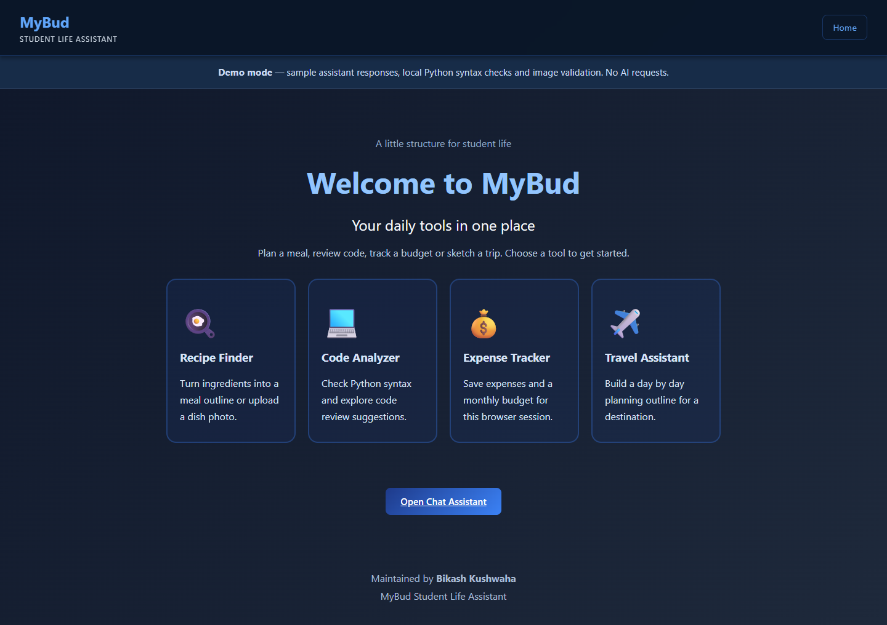

# MyBud Student Life Assistant

### A Django portfolio edition maintained by Bikash Kushwaha

MyBud brings five student utilities into one web app: recipes with image upload, code review, a monthly expense tracker, travel planning, and chat. This edition repairs the supplied starter's broken routes and service contracts and adds input validation, session isolation, regression checks, and clear setup instructions.

**The app starts in offline demo mode.** Chat, recipe and travel outputs use labelled examples. Code review performs real Python syntax parsing with fixed review tips. Image upload validates the image but does not classify food in demo mode. Expense operations save real data locally. Optional live mode sends submitted tool inputs and images to the configured Gemini model.



## Features and evidence

| Tool | Offline demonstration | Optional live mode |
| --- | --- | --- |
| Chat assistant | Fixed study-planning example | Gemini response to one message |
| Code analyzer | Python syntax checking through `ast.parse`, plus fixed tips | Structured code review suggestions |
| Recipe finder | Ingredient-based illustrative meal outline | Generated recipes from ingredients |
| Dish image | Actual image validation with an explicit no-classification message | Tentative Gemini image description and recipe outline |
| Travel assistant | Destination-labelled outline for 1–30 days, with no destination lookup | Generated information and itinerary |
| Expense tracker | Real add, remove, budget and reset operations in SQLite | Same local database operations |

Code snippets are never executed. The app does not claim a trained food classifier, measured recognition accuracy, live travel lookup, or verified nutrition values. [Verification and limits](docs/VERIFICATION.md) records what was actually checked.

## Quick start

Use 64-bit Python 3.12. Open PowerShell in this folder:

```powershell
python -m venv .venv
.\.venv\Scripts\python.exe -m pip install -r requirements-lock.txt
.\.venv\Scripts\python.exe manage.py migrate
.\.venv\Scripts\python.exe manage.py collectstatic --noinput
.\.venv\Scripts\python.exe manage.py runserver 127.0.0.1:8000
```

Open `http://127.0.0.1:8000/`. Stop the server with Ctrl+C. No API key or external model download is needed for the demo. The first development start generates an ignored `.local-secret-key` so local Django session signatures remain stable across restarts. Keep it private together with the local database.

On macOS/Linux, use `python3 -m venv .venv` and `.venv/bin/python` in place of the Windows executable path.

### Optional live AI

Copy `.env.example` to `.env`. Set the following values, then restart Django:

```dotenv
MYBUD_MODE=live
GEMINI_API_KEY=your_private_key
GEMINI_MODEL=an_available_model_for_your_account
```

Choose a model that supports the required text/image inputs and JSON output. Model availability depends on the account. The SDK integration uses `google-genai`, a 30-second HTTP timeout and one SDK attempt. Missing configuration returns HTTP 503. Provider failures and invalid response shapes return a sanitized HTTP 502. Live requests have a basic per-session, per-process limit of ten requests per minute.

**Live Gemini calls were not tested with credentials.** Tests cover successful and failed provider boundaries with mocks. Configure your own credentials and verify a live call before describing the integration as live-tested. See the official [Python SDK documentation](https://googleapis.github.io/python-genai/) and [image understanding guide](https://ai.google.dev/gemini-api/docs/image-understanding).

## Architecture

```text
Browser forms and safe text rendering
    -> Django page routes and CSRF-protected JSON APIs
    -> validated input and one demo/live assistant boundary
       -> offline examples / Python syntax parsing / image validation
       -> optional Gemini SDK request with response shape validation
    -> session-scoped expense service
       -> SQLite monthly budgets and exact Decimal amounts
```

| Location | Purpose |
| --- | --- |
| `main/views.py` | HTTP contracts, validation errors, provider boundary and rate limit |
| `main/services/assistant.py` | Input/image validation, demos, SDK integration and output schemas |
| `main/services/expenses.py` | Browser-session ownership, monthly queries and exact money arithmetic |
| `main/models.py` | Expense and monthly budget records with database constraints |
| `templates/` and `static/` | Six pages, dark blue styling, forms and safe DOM rendering |
| `main/tests.py` | Regression tests for tool APIs, CSRF, amounts and session isolation |
| `.github/workflows/checks.yml` | Automated checks prepared for GitHub Actions |
| `docs/` | Technical report, presentation, screenshots, API contract and verification |

Technology: Python 3.12, Django 5.2, SQLite, vanilla JavaScript, HTML/CSS, Pillow, google-genai, WhiteNoise and Ruff. Direct dependencies and the full checked environment are pinned. No frontend build, CDN script or Node runtime is required to run the app.

## Checks

After installation and static collection:

```powershell
.\.venv\Scripts\python.exe manage.py check
.\.venv\Scripts\python.exe manage.py makemigrations --check --dry-run
.\.venv\Scripts\python.exe manage.py test main --verbosity 2
.\.venv\Scripts\python.exe -m ruff check .
.\.venv\Scripts\python.exe -m ruff format --check .
```

The local suite passed with 23 tests. Browser checks exercise all five tools, actual expense persistence, image upload validation, HTML escaping, and six page layouts at desktop/mobile viewport sizes. See [the complete verification record](docs/VERIFICATION.md). The CI workflow is included; no remote CI result is claimed.

## Report and presentation

| Download | Contents |
| --- | --- |
| [Technical report PDF](docs/reports/MyBud_Project_Report.pdf) | Purpose, architecture, tool behaviour, database design, validation, setup and limitations |
| [Editable PowerPoint](docs/presentation/MyBud_Student_Life_Assistant.pptx) | Ten-slide project walkthrough |
| [Presentation PDF](docs/presentation/MyBud_Student_Life_Assistant_Slides.pdf) | Matching slide view for sharing |

Screenshots: [expenses](docs/screenshots/02-expenses.png), [code review](docs/screenshots/03-code-analysis.png), [recipes](docs/screenshots/04-recipes.png), [travel](docs/screenshots/05-travel.png), [chat](docs/screenshots/06-chat.png), and [mobile](docs/screenshots/07-mobile.png).

## Data and deployment

Expenses use **NPR** and the current calendar month in `Asia/Kathmandu`. Each browser's server-side Django session owns its records. Two browsers see separate data. Clearing session cookies loses access to previous records. There is no account recovery, login flow for student tools, bank connection, or persistent chat history. Back up the database and secret together when needed.

The clean package excludes `.env`, `.local-secret-key`, SQLite files, cached bytecode, dependency environments, and the original academic submission files. [Deployment instructions](docs/DEPLOYMENT.md) describe local GitHub publication and conventional persistent hosting. The SQLite app requires a durable writable disk; an ephemeral serverless filesystem cannot preserve its expense data.

## Maintainer and source

**Bikash Kushwaha** maintains this portfolio edition, its corrections, verification and documentation. The app derives from supplied starter code. [Source acknowledgement](SOURCE_ACKNOWLEDGEMENTS.md) describes that scope without claiming sole authorship of the original application. Original submission identities, roll numbers, certificates and signatures are outside this edition.
